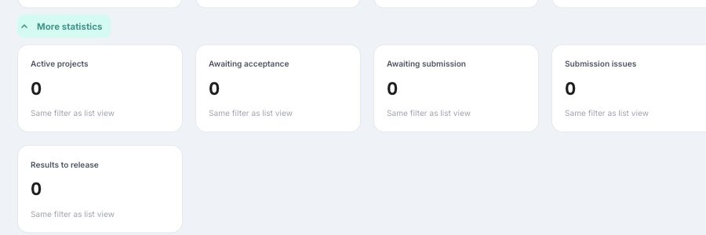
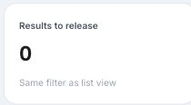
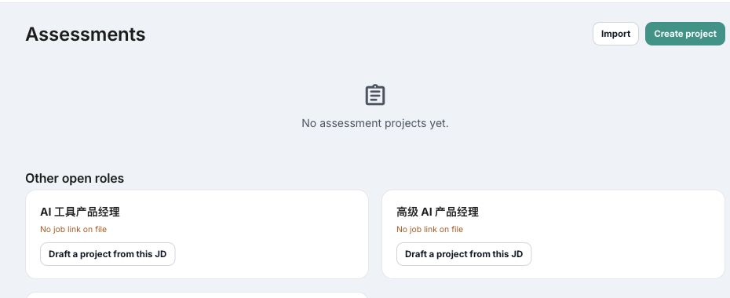
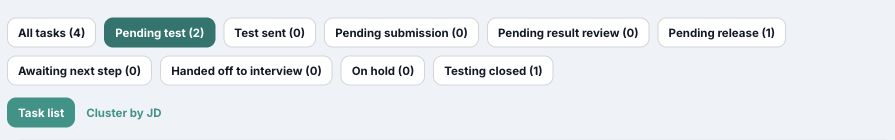
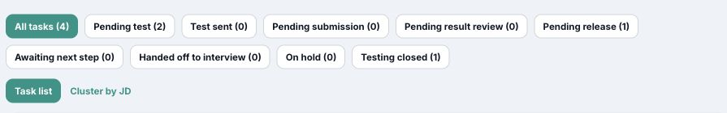
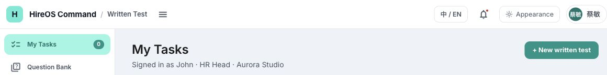
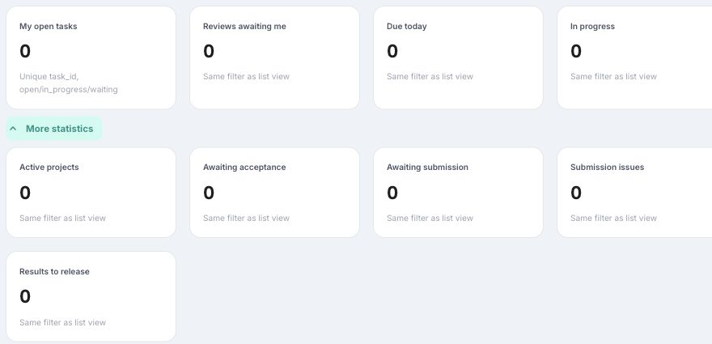
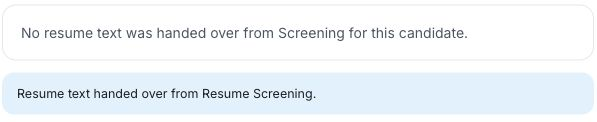

# W13 线上问题草稿（2026-10-16）

依据 [线上测试报告](Test_Report_2026-10-16.md)。这六份草稿已于 2026-10-17 提交为 GitHub Issue，并在各 Issue 正文嵌入固定提交版本的截图：[ #406](https://github.com/TelyAgent/HireOSV2/issues/406)、[#407](https://github.com/TelyAgent/HireOSV2/issues/407)、[#408](https://github.com/TelyAgent/HireOSV2/issues/408)、[#409](https://github.com/TelyAgent/HireOSV2/issues/409)、[#410](https://github.com/TelyAgent/HireOSV2/issues/410)、[#411](https://github.com/TelyAgent/HireOSV2/issues/411)。线上构建号未知；截图截取自 2026-10-16 的 Chrome 线上会话。Estimate 是建议值，待 Owner 确认；身份、数据源和服务端行为未核实处保留为待查，不据此声称越权或数据丢失。

## 草稿 1｜更多统计缺少 Delivery issues

**标题：** `[Bug] W13 More statistics 缺少 Delivery issues 指标`

- **Type / Subsystem / Severity / Risk：** Bug / hireos-written / S3 / low
- **Problem：** 展开 My Tasks 的 More statistics 后，线上只显示 Active projects、Awaiting acceptance、Awaiting submission、Submission issues、Results to release 五张卡。W13 PRD FR-3 和 §12 还要求 Delivery issues，HR 无法从首页发现待人工处理的交付异常。
- **User Outcome：** 授权用户在更多统计中看到 Delivery issues 的唯一逻辑 Delivery 数量，并能找到对应异常记录。
- **Scope：** 第六张卡、授权范围内的去重口径、零/非零/失败状态与下钻。
- **Non-goals：** 不更改交付重试或通知发送流程。
- **Acceptance Criteria：**
  - **AC-1：** More statistics 展开后包含 Delivery issues，且零值、非零值及更新时间明确。
  - **AC-2：** 同一逻辑 Delivery 的多次 retry 只计一次；无权限记录不计入。
  - **AC-3：** 点击卡片进入同口径异常列表；自动测试覆盖去重、权限和下钻一致性。
- **References：** [W13 PRD FR-3/§12](PRD.md)、[测试报告 W13-UI-01](Test_Report_2026-10-16.md#发现与最小修复方向)、[线上观察 E03](evidence/2026-10-16/live-observations.txt)。
- **Dependencies：** Delivery 数据源、授权范围与列表入口需确认；W13 主 Issue 尚未确定。
- **Owner / Estimate / AI Ready：** 待 Owner 指定 / TBD / No。估算解除条件：确认 Delivery 记录来源、去重键及可复用列表/API；目前可能跨服务，无法可靠给点数。
- **Reproduction：** 在线上打开 My Tasks，展开 More statistics；只出现五张卡。
- **Expected / Actual：** 预期包含 Delivery issues；实际缺少该指标。
- **Environment：** 2026-10-16，Chrome，`https://hireos.aipollo.me/hireos/written/tasks`；现有登录态，线上构建号未知。
- **截图：**

## 草稿 2｜指标卡没有同口径下钻

**标题：** `[Bug] W13 首页统计卡点击后未进入同口径过滤列表`

- **Type / Subsystem / Severity / Risk：** Bug / hireos-written / S3 / medium
- **Problem：** `Results to release` 卡片标注“Same filter as list view”，点击后仅进入通用 Assessments 页，没有待发布结果过滤或相应记录。`My open tasks` 卡片点击后仍在任务页且无可见过滤变化。用户无法解释数字或定位待办。
- **User Outcome：** 点击任一统计卡后看到与卡片完全相同授权范围和条件的明细，列表条数与数字一致。
- **Scope：** My Work 与 More statistics 各卡的过滤契约、路由参数、列表状态和非零数据回归。
- **Non-goals：** 不改变既有业务状态定义或跨模块任务所有权。
- **Acceptance Criteria：**
  - **AC-1：** 每张卡点击后进入有明确指标名称和过滤条件的列表，零值进入可解释的空列表。
  - **AC-2：** 非零卡片数与列表唯一记录数一致，授权范围一致；刷新和返回保留过滤。
  - **AC-3：** 自动测试覆盖 My open、Results to release 及其余指标的路由与计数一致性。
- **References：** [W13 PRD FR-4/§12](PRD.md)、[测试报告 W13-UI-02](Test_Report_2026-10-16.md#发现与最小修复方向)、[线上观察 E05](evidence/2026-10-16/live-observations.txt)。
- **Dependencies：** 各指标的服务端/前端数据来源及目标列表能力；W13 主 Issue 尚未确定。
- **Owner / Estimate / AI Ready：** 待 Owner 指定 / 5 / No。多指标、多个列表入口与权限/计数回归构成中等跨页面工作；建议点数待 Owner 确认。
- **Reproduction：** 在线上展开 More statistics，点击 Results to release；落到无对应过滤条件的 Assessments 通用页。
- **Expected / Actual：** 预期待发布结果明细；实际为通用项目页。当前卡片为 0，非零条数一致性尚未验证。
- **Environment：** 同草稿 1；线上构建号未知。
- **截图：**

## 草稿 3｜返回任务列表丢失筛选

**标题：** `[Bug] W13 从任务详情返回 My Tasks 后丢失原状态筛选`

- **Type / Subsystem / Severity / Risk：** Bug / hireos-written / S3 / low
- **Problem：** 在 Pending test (2) 筛选下打开任务详情，再用面包屑返回 My Tasks，会重置为 All tasks (4)。HR 处理多项同类任务时需重复筛选和定位。
- **User Outcome：** 用户从任务详情返回时继续看到原筛选、视图与位置，能处理下一项同类任务。
- **Scope：** My Tasks 过滤、Cluster by JD 视图和滚动位置的路由状态保留及返回回归。
- **Non-goals：** 不改变过滤分类、排序口径或任务详情内容。
- **Acceptance Criteria：**
  - **AC-1：** 从任一状态过滤进入任务详情并由面包屑返回后，原过滤仍选中，行数不变。
  - **AC-2：** Cluster by JD 与列表视图、滚动位置在返回时按设计保留；重新打开新入口时使用明确默认值。
  - **AC-3：** 自动测试覆盖详情往返和浏览器前进/后退。
- **References：** [W13 User Cases UC-W13-09](User_Cases.md)、[UX/UI 标准 U3/U8](../../HireOS_Command_JD_Management_UX_UI_Review_Standard_v1.0.md)、[测试报告 W13-UI-03](Test_Report_2026-10-16.md#发现与最小修复方向)。
- **Dependencies：** None；W13 主 Issue 尚未确定。
- **Owner / Estimate / AI Ready：** 待 Owner 指定 / 2 / No。局部路由状态和往返回归，建议点数待 Owner 确认。
- **Reproduction：** My Tasks 选 Pending test (2) → 打开该列表任一任务 → 点击详情面包屑 My Tasks。
- **Expected / Actual：** 预期仍是 Pending test (2)；实际变为 All tasks (4)。
- **Environment：** 同草稿 1；线上构建号未知。
- **截图：**

## 草稿 4｜登录身份显示不一致

**标题：** `[Bug] W13 My Tasks 登录人文案与页头账号名不一致`

- **Type / Subsystem / Severity / Risk：** Bug / hireos-written / S3 / medium
- **Problem：** 同一页面中，页头显示中文账号名，任务区却显示 `Signed in as John · HR Head · Aurora Studio`。无法确认“我的任务”与哪一个真实身份绑定；目前只有 UI 不一致证据，未证实越权。
- **User Outcome：** 用户能在页头与任务区看到一致、可核对的已认证身份、角色和 Workspace，并信任个人任务统计。
- **Scope：** 页头与 W13 页面身份来源对齐，角色/Workspace 显示，相关任务查询主体与缓存切换回归。
- **Non-goals：** 不凭本截图认定数据越权；不修改身份提供方或角色授权政策。
- **Acceptance Criteria：**
  - **AC-1：** 页头、My Tasks 说明与已认证 Identity 的姓名、角色、Workspace 一致。
  - **AC-2：** 切换账号或权限范围后，旧身份文案与任务数字不短暂显示，API 只返回新范围数据。
  - **AC-3：** 自动测试覆盖两个不同账号以及权限受限账号的 UI/API 一致性。
- **References：** [W13 PRD FR-1/FR-12](PRD.md)、[测试报告 W13-UI-04](Test_Report_2026-10-16.md#发现与最小修复方向)、[线上观察 E02](evidence/2026-10-16/live-observations.txt)。
- **Dependencies：** 需核 Identity 会话与页头账号映射；W13 主 Issue 尚未确定。
- **Owner / Estimate / AI Ready：** 待 Owner 指定 / TBD / No。根因可能是仅展示层，也可能涉及任务查询身份或缓存；取得认证 API 与双账号证据后再估算。
- **Reproduction：** 用现有线上登录态打开 My Tasks，对比右上角账号名与 `Signed in as` 文案。
- **Expected / Actual：** 预期同一身份；实际两处姓名不同。服务端授权行为未验证。
- **Environment：** 同草稿 1；线上构建号未知。
- **截图：**

## 草稿 5｜指标零值缺少加载和新鲜度说明

**标题：** `[Bug] W13 首页指标缺少加载状态和 as-of 时间`

- **Type / Subsystem / Severity / Risk：** Bug / hireos-written / S3 / medium
- **Problem：** My Work 与 More statistics 卡片稳定画面只显示数字 `0`，没有 as-of 时间，也没有可见 Loading/Unavailable/Stale 文案。初次打开时，任务列表一度显示 0/空，随后加载为 4 条；未录到逐帧画面，不能据此断言每张指标卡在请求期间错误显示零，但当前 UI 确实无法说明数字的新鲜度。
- **User Outcome：** 用户能区分尚在加载、真实零值、接口失败和过期快照，且能知道统计截至何时。
- **Scope：** 指标状态模型、独立卡片加载/错误/过期显示、as-of、局部失败和可控注入回归。
- **Non-goals：** 不修改每项指标的业务计数口径；不把任务列表瞬时零值当作已证实的指标 API 故障。
- **Acceptance Criteria：**
  - **AC-1：** 受控延迟、真实 0、单项 500 与过期快照分别显示 Loading、0、Unavailable、Stale，且显示相应 as-of/未取得时间语义。
  - **AC-2：** 一个指标失败不清空其他卡；刷新后按新快照恢复。
  - **AC-3：** 自动测试覆盖四态、局部失败和身份切换时旧快照清除。
- **References：** [W13 PRD FR-5/AC-6](PRD.md)、[测试报告 W13-UI-05](Test_Report_2026-10-16.md#发现与最小修复方向)、[线上观察 E01/E03](evidence/2026-10-16/live-observations.txt)。
- **Dependencies：** 快照时间/失败状态的 API 来源与故障注入能力待确认；W13 主 Issue 尚未确定。
- **Owner / Estimate / AI Ready：** 待 Owner 指定 / TBD / No。若无服务端 MetricSnapshot/API，范围可能超出单页 UI；确认数据与缓存契约后估算。
- **Reproduction：** 打开 My Tasks，观察 My Work 与展开的 More statistics：卡片仅有数字和泛化说明，没有 as-of 或状态说明。
- **Expected / Actual：** 预期可识别数据状态与时间；实际只能看到 `0`。500 与 stale 尚未在线上注入。
- **Environment：** 同草稿 1；线上构建号未知。
- **截图：**

## 草稿 6｜简历抽屉提示相互矛盾

**标题：** `[Bug] W13 简历预览同时显示未交接与已交接正文提示`

- **Type / Subsystem / Severity / Risk：** Bug / hireos-written / S4 / low
- **Problem：** 同一候选人的 View resume 抽屉中，同时显示 `No resume text was handed over from Screening for this candidate.` 和 `Resume text handed over from Resume Screening.`。用户无法判断正文是否存在。截图只截取矛盾文案，未包含候选人姓名或联系方式。
- **User Outcome：** HR 在简历抽屉中看到与公共记录实际内容一致的单一、明确状态；若缺正文，知道下一步如何取得。
- **Scope：** 简历正文有/无两态的显示条件与文案；必要时核对来源字段。
- **Non-goals：** 不据此认定简历数据丢失；不改 Screening 到 Written 的交接协议或真实简历内容。
- **Acceptance Criteria：**
  - **AC-1：** 没有正文时只显示缺失提示和可行下一步，不显示“已交接正文”。
  - **AC-2：** 有正文时展示预览及准确来源，不显示缺失提示。
  - **AC-3：** 自动测试覆盖有正文、无正文及加载失败三种情况。
- **References：** [W13 PRD FR-8](PRD.md)、[测试报告 W13-CONTENT-06](Test_Report_2026-10-16.md#发现与最小修复方向)、[线上观察 E08](evidence/2026-10-16/live-observations.txt)。
- **Dependencies：** 需核公共简历字段及当前记录状态；W13 主 Issue 尚未确定。
- **Owner / Estimate / AI Ready：** 待 Owner 指定 / 1 / No。若仅修正文案条件并补状态回归属局部改动；数据源调查若发现协议问题需重估。
- **Reproduction：** 在 My Tasks 点击一个没有交接简历正文的候选人的 View resume，等待抽屉加载完成。
- **Expected / Actual：** 预期单一准确的正文状态；实际两条相反提示同时出现。
- **Environment：** 同草稿 1；线上构建号未知。
- **截图：**

