# W13 输入输出闭环：我的任务与首页统计

| 项 | 内容 |
|---|---|
| 模块 | W13 |
| 版本 / 日期 | v1.0 / 2026-10-16（草稿，待评审） |
| 同目录文档 | [产品文档](PRD.md) · [User Journey](User_Journey.md) · [User Cases](User_Cases.md) |
| 格式说明 | 见 [Written Test README](../README.md#闭环文档格式) |

## 1. 结构化规格

```yaml
flow_id: W13a              # 首页与统计
actor: hr_emma
seed: S0_employer
entry: W13a.N1
max_loop: 2
external: []

nodes:
  - {id: W13a.N1, type: action, do: "以身份 U 打开 My Tasks", inject: [http_500]}
  - {id: W13a.C1, type: check, expect: {ui: "显示登录人、角色、workspace；My Work ≤4 张卡；More statistics 默认折叠"}}
  - {id: W13a.G1, type: decision, on: "U"}
  - {id: W13a.C2, type: check, expect: {ui: "Emma：My open 3；Daniel：My open 1、Available to claim 1；Admin：My open 0", api: "数字按 PRD §12 口径，唯一 task_id"}}
  - {id: W13a.N2, type: action, do: "展开 More statistics"}
  - {id: W13a.C3, type: check, expect: {ui: "Active projects 1、Awaiting acceptance 0、Awaiting submission 2、Submission issues 1、Results to release 1、Delivery issues 0"}}
  - {id: W13a.N3, type: action, do: "点击任一指标卡"}
  - {id: W13a.C4, type: check, expect: {ui: "进入相同过滤条件的列表，条数与卡片数字一致"}}
  - {id: W13a.N4, type: action, do: "制造指标状态 S（加载中 / 0 / 接口失败 / 过期）"}
  - {id: W13a.C5, type: check, expect: {ui: "Loading、0、Unavailable、Stale 显示不同；局部失败不清空其他卡；有 as-of 时间"}}
  - {id: W13a.N5, type: action, do: "切换身份 / 范围到 hr_restricted"}
  - {id: W13a.C6, type: check, expect: {ui: "不闪现上一身份数字；显示受限范围的数字", api: "只返回授权范围数据"}}
  - {id: W13a.T1, type: terminal, state: no_change}

edges:
  - [W13a.N1, W13a.C1]
  - [W13a.C1, W13a.G1]
  - [W13a.G1, W13a.C2, {when: "U 属于 hr_emma / hm_daniel / admin_morgan"}]
  - [W13a.C2, W13a.N2]
  - [W13a.N2, W13a.C3]
  - [W13a.C3, W13a.N3]
  - [W13a.N3, W13a.C4]
  - [W13a.C4, W13a.N4]
  - [W13a.N4, W13a.C5]
  - [W13a.C5, W13a.N5]
  - [W13a.N5, W13a.C6]
  - [W13a.C6, W13a.T1]
---
flow_id: W13b              # 任务列表与视图
actor: hr_emma
seed: S0_employer
entry: W13b.N1
max_loop: 2
external: []

nodes:
  - {id: W13b.N1, type: action, do: "依次点击状态过滤 F"}
  - {id: W13b.C1, type: check, expect: {ui: "列表只含该状态；按钮上的数量与列表一致"}}
  - {id: W13b.N2, type: action, do: "切换 Cluster by JD"}
  - {id: W13b.C2, type: check, expect: {ui: "按岗位分组；组内 Compare candidates 只允许已评分候选人"}}
  - {id: W13b.N3, type: action, do: "点任务行进入业务页；点 View resume"}
  - {id: W13b.C3, type: check, expect: {ui: "进入对应计划 / 评审 / 发布页；返回时保留过滤；简历抽屉引用公共记录"}}
  - {id: W13b.T1, type: terminal, state: no_change}

edges:
  - [W13b.N1, W13b.C1]
  - [W13b.C1, W13b.N2]
  - [W13b.N2, W13b.C2]
  - [W13b.C2, W13b.N3]
  - [W13b.N3, W13b.C3]
  - [W13b.C3, W13b.T1]
---
flow_id: W13c              # 任务动作
actors: [hm_daniel, admin_morgan, hr_emma]
seed: S0_employer
entry: W13c.N1
max_loop: 3
external: []

nodes:
  - {id: W13c.N1, type: action, actor: hm_daniel, do: "对 t4（队列任务）Claim", inject: [concurrent]}
  - {id: W13c.G1, type: decision, on: "是否被他人先领取"}
  - {id: W13c.C1, type: check, expect: {db: "t4.assignee=user_daniel", ui: "Daniel My open 1→2，Available to claim 1→0"}}
  - {id: W13c.C2, type: check, expect: {ui: "This task was claimed by another reviewer + Refresh", db: "assignee 只有一人"}}
  - {id: W13c.N2, type: action, actor: hr_emma, do: "Start t5 / Wait t1（理由 W）/ Resume"}
  - {id: W13c.G2, type: decision, on: "W 是否填写原因与恢复条件"}
  - {id: W13c.C3, type: check, expect: {ui: "不能保存 Wait"}}
  - {id: W13c.C4, type: check, expect: {db: "status=waiting，原因、恢复时间 / 事件保存；仍计入 My open 和 Due/Overdue", record: "History 记录"}}
  - {id: W13c.N3, type: action, actor: hr_emma, do: "Assign t1 给 Daniel"}
  - {id: W13c.C5, type: check, expect: {db: "assignee 变更；不授予新数据权限", ui: "旧提醒撤销，Daniel 收到新分配"}}
  - {id: W13c.N4, type: action, actor: hr_emma, do: "尝试直接勾选完成 t1；再通过 Release 页发布结果"}
  - {id: W13c.C6, type: check, expect: {ui: "没有直接完成按钮", api: "手动完成接口不存在或返回 4xx"}}
  - {id: W13c.C7, type: check, expect: {db: "业务成功后 t1 completed", ui: "卡片、列表、提醒同步更新"}}
  - {id: W13c.N5, type: action, actor: hr_emma, do: "打开版本过期的任务"}
  - {id: W13c.C8, type: check, expect: {ui: "旧动作禁用并提示刷新"}}
  - {id: W13c.T1, type: terminal, state: task.completed}
  - {id: W13c.T2, type: terminal, state: task.updated}

edges:
  - [W13c.N1, W13c.G1]
  - [W13c.G1, W13c.C1, {when: "未被领取"}]
  - [W13c.G1, W13c.C2, {when: "concurrent"}]
  - [W13c.C1, W13c.T2]
  - [W13c.C2, W13c.T2]
  - [W13c.N2, W13c.G2]
  - [W13c.G2, W13c.C3, {when: "W = wait_no_reason"}]
  - [W13c.G2, W13c.C4, {when: "W = wait_valid"}]
  - [W13c.C3, W13c.T2]
  - [W13c.C4, W13c.N3]
  - [W13c.N3, W13c.C5]
  - [W13c.C5, W13c.N4]
  - [W13c.N4, W13c.C6]
  - [W13c.C6, W13c.C7]
  - [W13c.C7, W13c.T1]
  - [W13c.N5, W13c.C8]
  - [W13c.C8, W13c.T2]
```

## 2. 测试数据

| 名称 | 内容 |
|---|---|
| filter_all / filter_completed / filter_pending_test / filter_pending_submission / filter_pending_review | 原型的五个状态过滤 |
| wait_no_reason | Wait 不填原因 |
| wait_valid | 原因「Waiting for candidate's missing file」，恢复事件「file received」或时间 2026-09-13 |
| metric_loading / metric_zero / metric_unavailable / metric_stale | 指标接口延迟 / 返回 0 / 返回 500 / as-of 超过阈值 |
| baseline_tasks | t1 Alex release→Emma open；t2 Taylor review→Daniel open；t3 Casey 缺件→Emma waiting；t4 题库发布→队列 open；t5 计划 review→Emma in_progress；t6 旧交付恢复→Morgan completed |

## 3. 路径清单

| 路径 | 节点序列 | 数据 / 注入 | 终态 |
|---|---|---|---|
| P1–P3 各身份基线数字 | W13a N1 → C1 → G1 → C2 | hr_emma、hm_daniel、admin_morgan | no_change |
| P4 More statistics | W13a N2 → C3 | baseline | no_change |
| P5 指标下钻一致 | W13a N3 → C4 | 每张卡 | no_change |
| P6–P9 指标四种状态 | W13a N4 → C5 | metric_*（4 条）；http_500 | no_change |
| P10 切换范围不闪现 | W13a N5 → C6 | hr_restricted | no_change |
| P11 状态过滤 | W13b N1 → C1 | filter_*（5 条） | no_change |
| P12 Cluster by JD | W13b N2 → C2 | — | no_change |
| P13 深链接与简历 | W13b N3 → C3 | — | no_change |
| P14 Claim | W13c N1 → G1 → C1 | t4 | task.updated |
| P15 并发 Claim | W13c N1 → G1 → C2 | t4；concurrent | task.updated |
| P16 Wait 校验 | W13c N2 → G2 → C3 | wait_no_reason | task.updated |
| P17 Wait / Resume | W13c N2 → G2 → C4 | wait_valid | task.updated |
| P18 Assign | W13c N3 → C5 | t1 | task.updated |
| P19 只能业务完成 | W13c N4 → C6 → C7 | t1 | task.completed |
| P20 版本过期 | W13c N5 → C8 | — | task.updated |

## 4. 流程图（由规格生成）

```mermaid
flowchart TD
  subgraph W13a[首页统计]
    A1["N1 打开 My Tasks"] --> AC1["C1 ✔ 结构"] --> AG{"G1 身份"} --> AC2["C2 ✔ 基线数字"]
    AC2 --> A2["N2 More statistics"] --> AC3["C3 ✔ workspace 数字"] --> A3["N3 点卡片"] --> AC4["C4 ✔ 列表一致"]
    AC4 --> A4["N4 指标状态"] --> AC5["C5 ✔ 四种状态"] --> A5["N5 切换范围"] --> AC6["C6 ✔ 不闪现"]
  end
  subgraph W13b[列表]
    B1["N1 状态过滤"] --> BC1["C1 ✔ 数量一致"] --> B2["N2 Cluster by JD"] --> BC2["C2 ✔ 只比较已评分"] --> B3["N3 深链接"] --> BC3["C3 ✔ 返回保留过滤"]
  end
  subgraph W13c[任务动作]
    C1n["N1 Claim<br/>注入：并发"] --> CG{"G1"}
    CG -->|成功| CC1["C1 ✔ 归属变更"]
    CG -->|冲突| CC2["C2 ✔ 提示刷新"]
    C2n["N2 Wait"] --> CG2{"G2 有原因?"}
    CG2 -->|否| CC3["C3 ✔ 不能保存"]
    CG2 -->|是| CC4["C4 ✔ waiting 仍计数"] --> C3n["N3 Assign"] --> CC5["C5 ✔ 不授新权限"] --> C4n["N4 勾选完成?"] --> CC6["C6 ✔ 无此动作"] --> CC7["C7 ✔ 业务成功才完成"]
    C5n["N5 版本过期"] --> CC8["C8 ✔ 旧动作禁用"]
  end
```



## 5. 待确认

- 任务列表结构（PRD tab vs 原型状态过滤，PRD 待确认 1）；本闭环 W13b 按原型 / 现有实现建模，若改为四个 tab 需改写。
- 审批类任务是否存在（PRD 待确认 2）；t4、t5 依赖该决定。
- Claim / Assign / Wait、多任务类型后端未实现（`Task` 与 `Case` 1:1），W13c 大部分为 known gap。
- 现有接口：`GET /tasks`。
