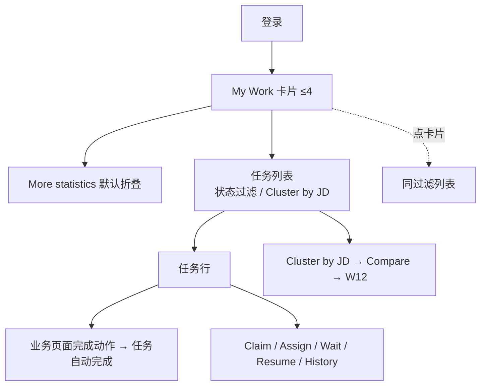

# W13 User Journey：我的任务与首页统计

| 项 | 内容 |
|---|---|
| 模块 | W13 |
| 版本 / 日期 | v1.0 / 2026-10-16（草稿，待评审） |
| 同目录文档 | [产品文档](PRD.md) · [输入输出闭环](Loop_IO.md) · [User Cases](User_Cases.md) |
| 来源 | [PRD v1.4 §12](../../../../hireos-written/docs/Assessment_Written_Test_PRD_v1.4.md)、[Brief v1.1 §5.1、§7、P16、P17](../../../../hireos-written/docs/Assessment_Written_Test_Prototype_Design_Brief_v1.1.md) |

角色与权限见 [W01 User Journey](../W01_Question_Bank/User_Journey.md#角色与权限公共)。

# 旅程

**主角色**：所有员工（HR、Hiring Manager / Reviewer、Operations、Admin）
**登录目的**：一打开就知道今天要做什么、有哪些卡住了，点一下就能去处理。
**入口**：登录后默认页 `#/tasks`

## 输入

| 类型 | 内容 |
|---|---|
| 前置数据 | S0_employer（任务 t1–t6，基线指标） |
| 用户数据 | 过滤、视图切换、Claim / Assign / Wait 操作 |
| 外部依赖 | 各业务模块产生的任务事件；通知服务 |

## 流程

## 步骤

| # | 用户意图与操作 | 系统反馈 | 用户需要判断 |
|---|---|---|---|
| 1 | 打开 My Tasks | 显示登录人、角色、workspace；My Work 卡片：My open tasks、Reviews awaiting me、Due today、In progress / Overdue | 今天先做什么 |
| 2 | 展开 More statistics | Active projects、Awaiting acceptance、Awaiting submission、Submission issues、Results to release、Delivery issues | 哪里有积压 |
| 3 | 点 Submission issues 卡 | 进入同过滤列表，条数一致 | — |
| 4 | 按状态过滤 | Written completed / Pending test / Pending submission / Pending result review，每项有数量 | — |
| 5 | 切换 Cluster by JD | 按岗位分组候选人；组内可 Compare candidates | 是否需要对比 |
| 6 | 点任务行 | 进入对应计划 / 评审 / 发布页；返回保留过滤 | — |
| 7 | View resume | 简历抽屉，引用公共记录 | — |
| 8 | （Daniel）Claim 队列任务 | 归属自己；Available to claim 减少 | — |
| 9 | 别人同时领取 | 「This task was claimed by another reviewer」+ Refresh | — |
| 10 | Wait | 必须填原因和恢复时间或事件；等待中仍计入期限 | 等什么、等到何时 |
| 11 | Assign 给同事 | 归属变更；旧提醒撤销；不自动授予对方数据权限 | 对方是否有权限 |
| 12 | 想直接标完成 | 没有勾选完成；需在业务页完成动作 | — |
| 13 | 切换身份或范围 | 数字刷新，不闪现上一身份的数字 | — |

## 可见 / 不可见

- 只看到自己有权限的任务和记录；Workspace Overview 是「可访问范围」的数字，不同人可能不同。
- 任务数不当作候选人人数或员工绩效。

## 异常与恢复

| 情况 | 系统表现 | 恢复 |
|---|---|---|
| 指标接口失败 | 该卡 Unavailable，其他卡正常 | 手动刷新 |
| 数据过期 | Stale + as-of | 刷新 |
| 并发领取 | 冲突提示 | Refresh |
| 任务版本过期 | 旧动作禁用 | 刷新 |
| Shell 离线 | 独立入口 My Tasks 仍可用 | — |

## 输出与交接

- 持久化：HumanTask（类型、归属 / 队列、状态、期限、等待原因）、TaskHistory、MetricSnapshot。
- 交接 → W03–W12 各业务页面（任务深链接）。

**禁止副作用**：勾选完成绕过业务；Wait / Cancel 计为完成；父子任务或重复事件虚增数字；转派授予数据权限；切换身份闪现旧数据。

**成功标准**：每个数字都能下钻到一致的列表；任务只随业务结果完成；多人协作时归属清楚。

**测试映射**：PRD 验收组 E；Brief P16、P17、§7 基线。

**待确认**：任务列表结构；审批类任务；Task 多类型建模；卡片组合（PRD 待确认 1–4）。
