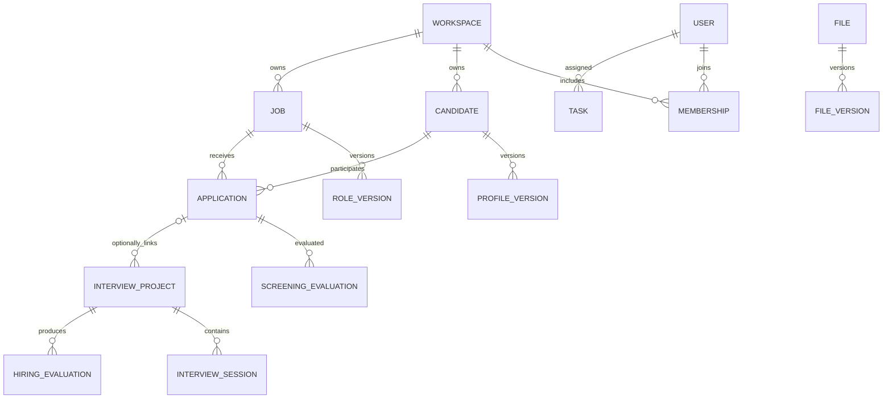

# HireOS Command — 公共数据底层与数据库规划

| 属性 | 内容 |
|---|---|
| 版本 / 日期 | v1.2 / 2026-09-11 |
| 主要读者 | 架构、后端、数据库、测试、运维；产品辅助评审 |
| 上位架构 | [统一账号、公共数据底层与模块接入架构 v2.2](HireOS_Command_Shared_Foundation_Data_Integration_and_Build_Plan_v2.2.md) |
| 状态 | 逻辑数据规划与实施约束，不是可直接运行的 DDL |
| 默认形态 | 共享 Postgres 实例/集群；服务独立进程与 schema；主档只能经 Core Record API 访问 |

## 1. 数据规划目标

账号只建一套；候选人、岗位、招聘关系、材料等公共实体只建一套。模块通过 Core Record 同步 API 复用公共主档及版本，不先复制独立主档再同步，也不取得主档数据库凭据。Postgres 共用基础设施，每个服务从第一天独立部署并管理自己的 schema。Identity 是账号唯一权威；Core Record 是业务主档唯一写入方。

私有部署复用同一 schema 规范和迁移实现，承载该部署自己的授权数据；不要求跨客户物理共库。业务模块停用不应删除其他模块依赖的公共记录。

## 2. 服务与 schema 的所有权

| schema 建议 | 唯一运行时写入方 | 核心实体 |
|---|---|---|
| iam | Identity Service | users、external_identities、workspaces、memberships、roles、entitlements、身份相关设置 |
| core | Core Record Service | candidates、contacts、profile_versions、jobs、role_versions、requirements、applications、cycles、files、file_versions 与 source refs |
| audit | Audit / Timeline Service | 审计事件、业务时间线投影、消费去重记录 |
| ai | AI Service | 模型目录、策略、预算、运行与尝试 |
| jd | JD 业务服务 | JD 编辑/生成项目、草稿工作记录；确认标准通过 Core Record 发布 |
| screening | Screening 业务服务 | 简历库视图、疑似重复处理、推荐、关联前评估、筛选评估、排序与偏好提案 |
| interview | Interview 业务服务 | 项目、输入 manifest、轮次、场次、答案、评分、Debrief、评估包 |
| assessment / offer | 对应业务服务，逐步接入 | 各自专属业务记录，字段随 PRD 细化 |

Core Record 的权威范围收敛为 **Candidate、Job、Application、File**。Profile、RoleDefinition、要求、材料版本和来源作为这四类主档的版本/从属数据，不扩展为业务决定中心。File 是公共文件主档，原 Material/MaterialVersion 应在数据字典中明确映射到 File/FileVersion，不能再创建另一套平行文件主档。

撤销上一版将公共 Task/Decision/通知默认交给 Core Record 的承载建议。人工任务及业务决定由来源业务服务拥有，L3 统一 Tasks 聚合获授权投影；Audit/Timeline 记录决定和变更的时间线/审计，不取得业务批准权。公共通知、交付状态等执行记录的服务归属需 S0 明确，不能按名称为“公共”就加入 core。

**Outbox/Inbox 不使用一个全域任意写入的中心表。** 每个事件生产/消费服务在自己的 schema 建 outbox/inbox；共享代码实现模式，共用总线传输。Audit 保存集中追溯投影，不取代来源本地事务事实。

基础服务先部署，业务 schema 随模块安装。Core 不设置指向可选业务 schema 的物理外键或触发器；业务模块仅保存公共 ID/版本作为逻辑引用。S0 默认不建立跨服务物理 FK、跨 schema 视图和 JOIN，避免迁移锁与级联耦合。服务内部的物理 FK 必须完整。

## 3. 公共核心对象与关键约束

### 3.1 身份与组织

| 表 | 关键字段与约束 |
|---|---|
| users | user_id 主键、状态、验证后的登录属性；无 module_id；邮箱可变，不作主键 |
| external_identities | user_id、issuer、subject；issuer+subject 唯一，用于外部 IdP 接入，不用于模块间账号映射 |
| workspaces | workspace_id 主键、企业状态 |
| memberships | workspace_id、user_id、status；同一用户同一组织有效关系唯一 |
| module_entitlements | workspace_id、module_id、启用状态；员工访问仍需 membership 与权限 |
| role_assignments | workspace_id、user_id、scope、role、有效期；岗位/案件角色引用明确作用域 |

用户身份可跨组织共用，候选人资料默认属于 Workspace。不能因平台 User 相同自动让多个企业读取相同 Candidate 档案。

### 3.2 Candidate、Profile 与材料

| 表 | 关键字段与约束 |
|---|---|
| candidates | workspace_id、candidate_id、状态、current_profile_version_id；全模块同一主档 |
| candidate_profile_versions | workspace_id、candidate_id、profile_version_id、version_no、来源、创建者与时间；每候选人版本号唯一 |
| candidate_contacts | candidate_id、类型、值、验证状态、来源与有效期；联系邮箱不自动作为身份唯一约束 |
| files | workspace_id、file_id、类型、内容存储引用、访问/保留范围 |
| file_versions | file_version_id、file_id、version_no、checksum、文件大小/格式、来源版本 |
| source_records | 来源邮件/附件/文件/外部系统标识、时间、operation_ref；同内容不同来源不丢 provenance |

同文件去重可以复用存储内容，不自动合并 Candidate。合并/拆分通过公共候选人命令执行，保留身份处理记录、旧 ID 解析和关联影响，不允许模块手工更新所有外键后删除痕迹。

### 3.3 Job 与 Application

| 表 | 关键字段与约束 |
|---|---|
| jobs | workspace_id、job_id、名称、招聘状态、负责人；无 JD 前端也可经授权创建 |
| role_definition_versions | role_version_id、job_id、JD 内容/材料引用、要求、Rubric 引用、draft/confirmed/published、版本 |
| requirements | role_version_id、requirement_id、类型、Must-have、说明与评分锚点；要求归明确版本 |
| applications | workspace_id、application_id、candidate_id、job_id、cycle_id、关系状态、link_decision_id |
| application_cycles | cycle_id、开始/关闭时间及重开原因；不复用旧周期覆盖历史 |

Core 内同一 Workspace、Candidate、Job、有效招聘周期只允许一个有效关系；由 Core Record 在自己的事务中执行唯一约束、权限和业务版本检查。不能把所有招聘阶段塞进 Candidate.status。

Screening 关联前推荐不创建 Application；人工 LinkDecision 成功后才创建/复用。Interview JD-only Project 可仅有 job_id/role_version_id，candidate_id/application_id 暂空；实际候选人评估前按该业务规则建立或关联公共关系。公共数据层不靠给可空字段塞虚拟 ID 满足约束。

### 3.4 非 Core 对象：证据、决定与任务的统一契约

EvidenceItem 指向公共材料/业务来源与精确版本；EvidenceLink 记录所支持/反驳的具体要求。证据结构统一，权威记录保存在产出模块的私有 schema；对外共享时生成版本化文件产物。公共 File 记录元数据，不接管证据业务语义。

DecisionRecord 保存决定类型、对象版本、责任主体、结果、理由、证据和替代关系；审批人的角色/数量由版本化业务策略定义。Task 引用 required_action、completion_rule、assignee/queue、source_module、source_version 和 completion_ref。DecisionRecord 与 Task 均归来源模块保存；L3 聚合任务投影、Audit 汇集审计。公共层不提供可绕过业务校验的任意“改为完成”接口。

## 4. 关系示意

图为关键关系摘要，不替代物理 ERD；项目准备阶段允许无 Application。版本引用、租户约束、任务队列和权限关系需在字段级设计补全。

## 5. 租户隔离与引用完整性

所有租户业务表携带 workspace_id。除全局 User 等明确全局实体外，跨表引用必须证明租户一致：服务内部使用 workspace_id+entity_id 的复合唯一键/外键；跨服务引用由权威 API 校验租户与版本，存入本服务后通过失效事件与定期对账维护。不能只依赖前端过滤，也不能声称跨服务逻辑引用具有数据库实时 FK 保证。

多态 subject_ref 的合法类型由注册表限制，并有应用验证；核心强关系优先使用明确外键。禁止任意 entity_type/entity_id 形成不可校验引用。

敏感数据查询由服务层/数据库权限共同限制；如采用行级安全，也应覆盖后台作业、导出和管理员路径。每个运行时数据库角色只能访问自身 schema；对 core/iam/其他业务 schema 不授予 SELECT 或写权限，也不通过跨域视图、函数或通用账号旁路。Core Record 的主档 API 与 Identity 的身份 API 是例外的允许服务调用，不是数据库授权。

## 6. 写入 API 与并发控制

Core Record 同步命令示例（Identity 管理账号不在此列）：CreateCandidate、PublishProfileVersion、ConfirmCandidateIdentity、CreateJob、ConfirmRoleVersion、ConfirmApplicationLink、RegisterFileVersion。名称仅为契约草案，不是已存在接口。

每个命令验证身份、Workspace、业务权限、expected_version、幂等键和关联状态。结果返回公共主键、实际版本、是否复用已有记录与错误码。更新采用乐观并发或必要锁定，禁止最后写入无条件覆盖。

模块专属扩展字段放在自身 schema，保留 Core ID/版本逻辑引用，不申请直写 core 扩展表。公共层应有扩展评审流程，不能任意添加多个同义字段或把核心条件塞进不可治理的 JSON。

## 7. 当前事实、历史快照与跨模块读取

主档当前指针便于统一查看最新资料；业务结果引用当次使用的 ProfileVersion、RoleVersion、MaterialVersion、policy/model/prompt 版本。两种语义不能混用。

内部流程通过 Core API 获取相同主档版本 ID，不重复导入文件；模块间经总线传递 ID、版本和变更摘要；详细结果以受控 FileVersion 产物交付，不能同步回调另一 L2 查询。需要冻结对外发布或第三方材料时生成受控快照，不把快照变为另一套可独立修改的候选人主档。

来源版本更新后发出影响事件；各模块判断其结果是否 stale、需重评或继续引用旧依据并说明。共享数据库中读取到更新，不等于已完成重新评分或重新批准。

## 8. 事务与可靠集成表

事务边界是单服务、单 schema。共享 Postgres 不授予跨服务事务权限。调用 Core Record 不属于调用模块数据库事务的一部分，禁止边持有业务数据库锁边等待整个远程流程完成。

关联确认采用可恢复步骤：Screening 本地保存 request_id 和意图 → Core API 幂等创建 Application 并返回 → Screening 本地保存引用及完成状态。Core 已提交但响应丢失时，按 request_id 查询/重试；本地写入失败则补写并对账。撤销通过授权补偿命令处理，不直接删除 Core 记录。

每个服务的 outbox 至少有 event_id、type/schema_version、workspace_id、aggregate_id/version、correlation/causation、payload、occurred_at、publish_status、attempt_count；同业务变化事务写入。Inbox 按 consumer+event_id 唯一，记录处理版本和结果；消费事务成功后才确认总线消息。

S0 事件总线用 Redis Streams；不同模块独立 consumer group，同模块多副本共享其 group。设计 pending 恢复、有限重试、死信/异常任务、保留和补放策略。Streams 不是永久权威记录，也不提供跨服务数据库事务。

直接持久化自身数据不经过总线；只有发布通知其他子系统的业务事实/请求才通过总线。机器作业队列与业务事件流分别管理，避免混用消费语义。

## 9. 文件、搜索和分析存储

关系数据库保存主档、关系、版本与权限；公共对象存储保存附件和音视频；搜索/向量索引与分析视图为可重建派生数据，不成为额外权威主档。

文件引用包含不可推断 key、版本、checksum、用途、权限和保留信息。预览/下载实时授权；存储路径不默认暴露姓名/邮箱。公共存储去重不能越过租户权限透露文件存在。

删除/撤回传播覆盖关系记录、内容、副本、索引、摘要与缓存；留存范围依据有效策略，不在本规划预设法律期限。已合法对外交付文件不能承诺强制远程召回。

## 10. Schema 治理与运维

- 为每个服务 schema 指定唯一 owner、迁移流水线及兼容契约；Core 主档字段变更由 Core owner 审核。
- 公共字段名、类型、枚举、时间、空值、币种、版本与删除语义进入统一数据字典。
- 迁移由各服务独立版本化执行，统一约束兼容发布顺序；优先新增兼容字段/回填/切换/最后移除，不让各模块各自执行冲突 migration。
- 模块声明兼容的公共 schema/API 版本；契约测试覆盖旧消费者，破坏性变更需明确迁移期。
- 备份、时间点恢复、灾难恢复和恢复演练覆盖共享基础；确认 RPO/RTO、容量、索引和维护窗口后才承诺服务指标。
- 高负载主档读取由 Core 自己提供批量 API、缓存或读副本；不向 L2 开放主档只读库连接。事件派生投影只读、带版本/新鲜度、可重建，不能成为第二主档。
- 审计基础层权限变更与跨域查询，监控慢查询、连接池、锁等待、Outbox 积压、复制/投影延迟。

## 11. 接入或迁移已有原型

1. 盘点是否真实存在多套账号或主档；本规划不假定已有实现。
2. 若存在账号重复，迁移到统一身份系统并保留审计；完成后停止旧模块账号注册与认证。一次性迁移映射不是正式运行架构。
3. 候选人/岗位去重归并经确认后落到公共主表，重新绑定专属记录；保留来源和旧引用解析，不能丢失历史评分。
4. 先迁移读路径，再切换受控写入口；清楚指定迁移期间权威来源，避免两套主档永久双写。
5. 对比行数、版本、引用、租户、权限和业务结果；准备恢复方案后切换。
6. 若仍是设计原型，直接使用公共 schema，不先制造将来必须归并的数据孤岛。

## 12. 下一步工程交付物

物理 ERD、字段级数据字典、数据库权限矩阵、公共命令/查询契约、迁移脚本、种子数据、索引与容量计划、身份/租户集成测试，以及两个模块共用同一用户/候选人/岗位/招聘关系的端到端验证。

Postgres、服务独立部署和 Redis Streams S0 已按开发图确定；版本、索引、容量和恢复指标仍需工程设计；本文已经确定“同一公共身份、同一核心业务数据、专属域隔离写入”的方向，不把这些重新留给各模块自行选择。

## 13. 凭据、Worker 与基础设施隔离

运行时每服务一个数据库角色/独立密钥，migration owner 与 runtime 分离。收紧默认 schema/search_path 和默认授予权限；禁止共享 superuser、跨域 SECURITY DEFINER 函数或拥有者继承绕过隔离。物理数据库共用不是共享凭据。

公共 Worker 可复用代码镜像，但按任务域部署 worker pool 并注入限定凭据；导入涉及主档时仍调用 Core API。AI/Agent 不获得通用 SQL 访问权。对象存储采用权限范围和临时访问，数据库与日志不保存可公开使用的永久链接。

Redis 缓存、job queue、Streams 配置隔离的 key/ACL/容量和淘汰策略，评估分实例；持久化、备份、重放窗口必须与 Postgres Outbox 的保留策略协调。测试消息发布后、消费事务提交前后分别宕机的恢复行为。

## 14. 分阶段数据库交付门槛（原文图 5）

| 阶段 | 数据建设 | 验收重点 |
|---|---|---|
| S0 | iam/core/audit、L0、空 Shell、契约仓库与 CI；公共运行基础 | Identity/Core 唯一权威；数据库权限、幂等和恢复 |
| S1 | jd 私有 schema | 主档只能经 Core API 发布，单模块运行 |
| S2 | screening 私有 schema；I2 事件打通 | 共用 Job/Candidate/Application/File ID，JD 业务代码无需为接入改动 |
| S3 | assessment/interview 私有 schema；I3 编排 | 多方消费者、统一 Tasks 投影与回执 |
| S4 | offer 私有 schema；I4 统一体验和指标 | 全量组合、度量口径一致，已有私有数据域不合表 |

S0–S4 是完整原文的规划顺序，不是本次确认的上线进度。I0/I1 和正式 AD 决策详情需后续原始文档核验。

## 15. 事件轻量化与详细产物交付

原文要求事件只带 ID 和变更摘要；不能广播完整简历、评分报告或音视频。事件包含主档 ID、对象/契约版本、相关文件版本 ID、最小摘要和关联信息。

为同时满足“L2 不直调”和“事件不带全量报告”，建议来源 L2 先通过 Core Record 注册可交付 FileVersion，保存对象存储中的必要产物，再发布事件。目标经 Core API 验权取得文件并形成本地输入 manifest；来源专属评估仍是来源 L2 权威。未获授权的内部笔记不进入该产物。注册成功但事件未发布时通过本地请求记录与 Outbox 对账，不以跨服务事务解决。

这种产物交付是本次补充实施方法，需契约评审；不是完整原文已经给出的字段级方案。文件仅为交换产物，不成为主档复制或第二份可写评估。

Schema Registry 采用文件仓库 + CI，不设置运行时数据库注册依赖。Postgres/pgvector 在图 4 出现，向量数据仅为授权派生索引；事件总线归 L0，迁移 Kafka 时保留业务契约并验证传输语义。

本版已于 2026-09-11 依据完整 5 页 PDF 逐页复核图 1–5；未获得原文列出的正式架构 Markdown、AD-001～009 和物理部署基线文件。来源说明见上位架构 §16，复核裁定见 §17。

## 16. 完整 PDF 复核补充

- File/FileVersion 为统一规范名；历史 PRD 的 Material/MaterialVersion 是映射别名，不增加另一套公共文件表。
- 文件采用 uploading → ready / failed 状态。内容上传并校验完成后才允许事件引用；来源本地评估、公共文件注册、消息发布用可恢复步骤衔接，不构造跨服务事务。
- 详细评估产物至少包含 artifact_schema_version、来源业务 ID/版本、公共主档 ID/版本、证据文件版本引用及授权范围；接收方核验版本、权限和完整性。具体 JSON schema 由开发契约评审确定。
- 通知/连接运行记录使用公共平台自有 schema，平台团队拥有，Worker 凭据受限；不放入 core 或复制到每个业务模块。源业务任务/批准记录保留私有 schema，统一 Tasks/审计只读聚合。
- Candidate/Job 可有只读派生投影；投影须可重建并标记来源版本和新鲜度，不能写回替代主档。
- Application 定义为已确认 Candidate × Job × 招聘周期关系，不能将收到邮件立即视为有效关联。收到简历但尚未确认岗位时，仅保存 Candidate/File/来源记录；来源中的“这次投递”不覆盖现有 Screening 人工关联规则。
- 岗位草稿、生成尝试归 JD 私有域；对外确认/发布的 Job 和要求版本归 Core。其他模块独立使用时可通过公共接口提供所需岗位输入，无须启用 JD 子系统。
- schema 及 API 允许兼容演进；身份主键和数据所有权从 S0 固定，不等于全部字段在 S0 永久冻结。
- 数据建设按完整系统规划；私有表按已选模块增量实现。图 5 为建议顺序，商业上线优先级仍待确认。
