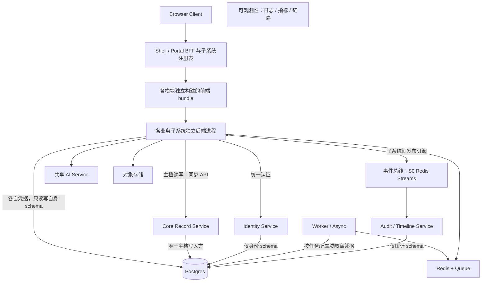

# HireOS Command — 统一账号、公共数据底层与模块接入架构

| 属性 | 定义 |
|---|---|
| 版本 / 日期 | v2.2 / 2026-09-11 |
| 主要读者 | 技术负责人、架构师、后端、前端、数据库、测试与运维团队 |
| 次要读者 | 产品经理与设计团队 |
| 状态 | 技术架构基线；Postgres、Redis 与 S0 Redis Streams 及独立部署形态按开发反馈确定；容量、版本和服务指标待工程确定，不代表已实现 |
| 配套数据库规划 | [公共数据底层与数据库规划 v1.2](HireOS_Command_Common_Data_Foundation_and_Database_Plan_v1.2.md) |
| 本次变更 | 同一用户同一账号与 user_id；各模块直接共用公共业务实体及数据基础，不以各模块建库复制再映射作为默认方案 |

## 1. 强制架构决策

本版按用户最新反馈替代 v1.0 中“模块各自维护核心档案，再通过集成映射共享”的默认方案。

1. **统一账号**：一套身份系统、一套用户主表、一个稳定 user_id、一套统一认证体系。用户通过同一账号登录全部获授权模块。禁止各模块自行注册账户、保存密码、签发独立业务登录身份，再通过后台映射拼接。
2. **统一数据底层**：建设独立维护的公共数据层，所有业务模块共用同一套 Candidate、Job、Application、File 四类主档及其版本/从属关系；任务等其他公共机制单独明确责任。不是只有名称和 JSON 格式相同，而是使用同一份公共记录。
3. **模块专属数据可分域**：面试、筛选、测评、Offer 的专属记录分别拥有明确 schema、表和写入责任，但直接引用公共实体，不复制另一套候选人、岗位或账号主档。
4. **统一公共能力**：账号、配置、文件、邮件、任务、审计、模型配置和共享组件建设一次，模块注册自身业务规则后使用。
5. **独立运行的新定义**：公共基础层（统一身份 + 公共数据 + 必需公共运行能力）加任意业务模块即可运行；不需要其他业务模块安装或在线。
6. **同部署优先共享记录**：内部无需通过邮件重复运输已有公共数据。主档统一调用 Core Record 同步 API；业务子系统间的消息与交接仅通过事件总线，不互相同步调用或跨 schema 查询。
7. **外部交换继续保留**：邮件、文件、上传与结构化接口用于外部输入输出、人员通知、不同部署之间的受控交换及恢复。

共用数据库不等于任意模块可随意写所有表；共用账号也不等于用户自动拥有全部模块与候选人权限。

## 2. 部署模型与依赖边界



图为开发反馈的文字化实现视图；每个服务和业务后端为可独立发布的进程，每个子系统前端为独立构建产物。服务间箭头是允许的调用关系，不表示应用持有整个 Postgres 的权限。对象内容访问经授权文件能力或临时授权完成。


**从 S0 起即采用 N 个独立部署单元，不先做模块化单体再等待拆分。** 共享 Postgres 基础设施，每个服务/业务子系统拥有自己的 schema 和独立数据库凭据。Core Record 是主档唯一写入方；所有业务模块读写主档都调用其同步 API，拿不到主档数据库连接。统一账号由 Identity Service 管理，不能混为 Core Record 的用户副本。

| 使用方式 | 交付形式 |
|---|---|
| 只购买 Interview | 公共身份与数据底层 + Interview；Candidate/Job/Material 等公共能力随基础层可用 |
| 同时使用两个模块 | 同一账号、同一公共数据实例；两个专属业务域并存 |
| 开通全部模块 | 继续使用既有公共实例，增加模块权限、专属 schema 与流程规则，不迁移到另一套账号/主档 |
| 客户私有部署 | 部署同一公共底座实现与所选业务模块；可连接企业 IdP，但不为每个模块另建认证体系 |

单模块可由自己的 UI 调用公共能力创建岗位或候选人；不要求 JD 或 Screening 前端先完成操作。基础数据库不可用会影响依赖它的模块，这是显式的公共基础设施依赖，需通过备份、恢复、容量和高可用设计治理，不能宣称完全不受影响。

## 3. 统一账号与单点登录

### 3.1 唯一身份与组织关系

- `iam.users.user_id` 是平台用户的唯一稳定主键；邮箱是可变、需验证的属性，不作主键。
- `iam.workspaces` 表示企业/租户；`iam.memberships` 记录 User 在 Workspace 内的有效成员关系。
- 同一个用户可加入多个 Workspace；登录身份不变，当前 Workspace 和权限分别核验，数据不能跨租户泄漏。
- 企业只维护一套模块 entitlement 与授权策略；模块不得生成自己的用户主档或密码库。
- 与外部企业 IdP 对接时，身份来源可关联到统一 user_id；这种外部身份联邦不是各子系统账户映射。

### 3.2 登录与授权请求链

```text
用户打开任一模块 URL
→ 跳转统一身份入口或复用有效 SSO 会话
→ 模块验证统一签发的会话/令牌及其受众、有效期
→ 解析同一个 user_id 与当前 workspace_id
→ 校验 membership、模块开通与角色权限
→ 对具体候选人/项目/动作执行对象级授权
```

身份协议可选企业标准 SSO/OIDC 等实现；具体产品待定。各模块的客户端注册或隔离会话不等于独立账号，但必须引用同一用户主键与同一认证权威。禁止仅信任前端传来的 user_id/workspace_id。

用户修改邮箱、停用成员或撤销权限在统一系统完成。各模块授权缓存必须有明确有效期与失效机制，敏感操作提交时检查当前权限；不得承诺仅删除账号便可瞬时回收所有已签发离线令牌。

### 3.3 业务角色与候选人身份

HR、Hiring Manager、Interviewer 等为具体岗位/案件上的 RoleAssignment，统一引用 user_id，不复制人员账号。同一人可在不同岗位担任不同角色。

候选人不必拥有员工 Membership。若需登录，使用统一身份系统支持的受限参与者身份，并通过授权关系关联 Candidate；内部 Candidate 业务记录与登录用户是两个对象。仅收到 CV 不应创建员工账号，不能把相同邮箱自动视为跨租户同一候选人。

## 4. 公共数据底层

### 4.1 同一份公共业务记录

| 公共对象 | 共用方式 | 禁止的实现 |
|---|---|---|
| User / Workspace / Membership | 全模块引用统一 ID 与记录 | interview_user、screening_user 各建账号再映射 |
| Candidate / CandidateProfileVersion | 全模块共用候选人及资料版本 | 每个模块自行维护一套候选人主档 |
| Job / RoleDefinitionVersion | 共用岗位身份与版本化要求 | 按模块复制岗位表，再靠标题同步 |
| Application | 共用确认后的 Candidate × Job × 招聘周期关系 | 相同招聘关系在每个模块分别重建 |
| Material / MaterialVersion | 同一受控文件记录、内容与来源 | 为内部转交重复上传相同材料 |
| Task / DecisionRecord / Audit | 任务与决定归来源业务；统一契约、L3 聚合、Audit 时间线投影 | 将任务、决定全部塞入 Core，或让聚合视图改写来源业务事实 |

跨模块需要独立保存的是各自的业务产物及其**输入版本引用**，而不是重复维护公共主档。已确认评估绑定具体 Profile/JD/Material 版本，不随主档当前版本自动改变。

### 4.2 公共实体存在不依赖业务模块

候选人资料由公共 Candidate 能力创建和维护；Screening 拥有简历库业务视图、身份复核与匹配流程。岗位公共记录可以由 JD 模块或其他获授权模块通过公共接口建立；只有已发布版本的标准才按规则进入正式评估。

Application 的结构、唯一性与引用归公共层；何时允许建立由业务用例约束。Screening 保留“人工确认关联后创建”的规则；JD-only 的 Interview Project 在准备阶段无需 Candidate/Application；关联前匹配同样无需虚构 Application。

### 4.3 公共层不拥有业务判断

公共层校验租户、引用、版本和数据不变量。面试评分、筛选 eligibility、人工关联批准、Offer 条款批准仍由相应业务模块实施。DecisionRecord 使用统一契约，但由来源业务保存；公共服务不能据此任意批准所有业务。

## 5. 数据库访问与写入规则

所有模块接入同一数据基础，但不默认授予所有表的写权限。

| 数据范围 | 写入路径 | 读取路径 |
|---|---|---|
| 用户、组织、权限 | Identity Service 写自身 iam schema | Identity API/统一令牌与授权机制 |
| Candidate、Job、Application、File 四类主档及版本/从属数据 | Core Record 同步 API，唯一写入服务 | Core Record 同步 API；不提供业务库主档连接或直读视图 |
| 模块专属表 | 模块后端直连自身 schema，在本地事务中写入 | 本模块后端直读自身 schema |
| 其他业务模块的产物 | 不跨模块写表 | 通过总线请求/事件获得授权结果及版本化内容；可维护只读投影 |
| 审计/Timeline | 独立 Audit / Timeline Service 写自身 schema | 受权审计查询接口 |
| AI 运行记录 | AI Service 管理自身 schema | AI 公共接口 |

**三条访问路径不得混淆：自己的业务表直连；公共主档走 Core Record API；L2 业务子系统间只走事件总线。** “唯一通道”限定为 L2↔L2 后端通信，不禁止浏览器调用自己的后端，也不禁止业务模块调用 Identity/Core Record/AI 等公共服务。

禁止 BFF、Worker 或数据库管理员通用凭据成为旁路。跨域统一视图应消费授权事件或公共 API，不通过跨 schema JOIN 读取其他模块的私有表。schema 迁移由所属服务流水线执行并经过公共兼容性治理，不要求每次所有模块一起发布。

## 6. 同系统共享与跨系统传输

| 情况 | 处理方式 |
|---|---|
| 同部署两个模块查看同一候选人 | 通过 Core Record 同步 API 读取同一 candidate_id 与资料版本，不发邮件同步候选人主档 |
| Screening 向 Interview 交接 | 经事件总线发送有授权依据的业务请求，携带公共 ID、版本、变更摘要与受控 File/FileVersion 引用；Interview 创建自己的项目/输入记录 |
| 原始文件较大 | 公共材料引用与受控对象存储，避免消息携带全文音视频 |
| 第三方 ATS 或邮件/文件导入 | 校验与规范化后写入公共数据底层；身份歧义走复核 |
| 不同私有部署之间交换 | 使用版本化数据包、外部来源标识与接收方授权，不跨部署直接读库 |
| 人员通知 | Email + 任务 URL；候选人统一 hr@，内部模块邮箱通知个人公司邮箱 |

结构化契约依然必要：用于主档同步 API、子系统总线命令/事件、外部接口和可兼容升级。数据库共用不能代替“什么时候允许推进”的业务协议。

外部 ID 映射仅用于第三方/跨部署记录，不是内部用户账户和内部公共主档共享的默认路径。独立部署之间如未来合并实例，需专门的数据与身份归并方案，不能假定相同邮箱即可直接合库。

## 7. 事务、事件和一致性

### 7.1 本地事务与跨模块执行

每个服务只在自身 schema 内提交本地事务。即使物理上共用 Postgres，也不允许一个业务事务跨 Identity、Core Record 和业务 schema 写入。

例如关联确认：Screening 保存请求意图及稳定 request_id → 调 Core Record 的幂等 ConfirmApplicationLink → Core Record 在自己的事务内创建/复用 Application 并提交 → Screening 保存返回引用及后续任务。响应丢失时按同 request_id 查询/重试，不能猜测失败后重建关系。

调用主档成功而本地保存失败时进入待对账状态；恢复后取回同一结果并补全。不能回滚已经成功的远端事务，也不能因本地失败自动删除其他模块已引用的主档。确需撤销需经授权补偿命令与业务条件校验。

跨模块流程：来源模块自身事务写结果与 Outbox → 发布总线 → 目标模块 Inbox 去重并提交自身业务结果 → 回执事件。禁止跨服务持有长事务。

### 7.2 明确分离的状态

`ScreeningCompleted` 是事实；`StartInterviewRequested` 是请求；`InterviewIntakeAccepted` 是接收处理；`InterviewStarted` 是业务执行。不能因为公共表能被读取就自动发出面试邀请。

Outbox、Inbox、exchange_id/version、expected_version、业务唯一约束、重试和对账共同防止遗漏和重复业务效果。共享数据库也不能消除邮件服务故障和异步消息重复。

### 7.3 版本与引用

已发布 Profile/Role/Material/Evaluation 版本原则上不可变，修订生成新版本；评估保存输入 manifest，当前指针更新不改变历史依据。来源变化通知相关业务产物复核；删除与保留按数据策略处理，不能以“不可变”无限保留应删除的个人内容。

## 8. 公共能力与界面组件建设

公共服务、共享组件与接口运行库统一维护。各模块只注册或实现业务扩展，不重复开发同一基础功能。

| 共用建设 | 模块扩展 |
|---|---|
| Settings、Appearance、成员和权限 | 模块特有配置 schema 与可操作角色 |
| Files、Connections、Activity | 输入分类、映射确认、业务消费回执 |
| My Tasks、Approval、通知 | 任务完成规则、单/双签、收件角色和业务模板 |
| AI 模型目录、预算、评测、回退 | task_type、领域 Prompt、质量门槛、业务输出验证 |
| 统计、比较矩阵、证据查看组件 | 指标口径、可比条件、来源评估和下一步决定 |

公共层有统一发布与兼容策略，不要求每个模块重复实现“本地版”。私有部署复用同一组件和服务实现，不使用另一套账号/核心实体。

## 9. 参考交接：Screening → Interview

1. 员工通过统一账号登录，操作均使用同一 user_id 和 workspace_id。
2. 简历导入公共 Material/Profile；Screening 使用公共 candidate_id，形成关联前推荐。
3. HR/HM 有效确认后，公共层创建或复用同一 Application；Screening 保存自己的评估及输入版本。
4. 用户明确选择“交给面试”，保存业务请求、决定引用与 Outbox。
5. Interview 接收请求，引用同一个 candidate_id、job_id、application_id、role/profile/material 版本，不新建账号或复制主档。
6. Interview 创建专属 Project/Round/Session；相同人员通过统一 user_id 分配任务。
7. interview@ 向内部员工个人邮箱发任务；候选人通过 hr@ 收到安排与提醒。
8. Interview 产出 Hiring Evaluation，保存独立结果与公共版本引用；Offer 如已启用则接受下一步请求，未启用时可导出结果。

仅启用 Interview 时，员工直接在 Interview 中调用公共岗位/材料能力创建 JD-only 项目，候选人可后加；不需要先运行 Screening 或 JD 模块。

## 10. 建设阶段与迭代门槛（按完整原文图 5 修正）

| 阶段 | 新增 | Shell 与组合能力 | 已有模块变更目标 |
|---|---|---|---|
| S0 地基就绪 | L0、L1、空 Shell；公共 AI/Worker 按基础能力部署 | 注册/认证骨架；尚无业务上线 | 不适用 |
| S1 首个上线 | JD | 单系统入口、独立可运行 | 无已有模块 |
| S2 第二个上线 | Screening | 跨系统视图，一二合并；I2 事件打通 | JD 无需因新模块而修改业务代码 |
| S3 第三、四个接入 | Assessment、Interview | 统一 Tasks，一至四合并；I3 编排打通 | JD/Screening 无需因组合改业务代码 |
| S4 全量组合 | Offer 与统一指标 | 五模块组合；I4 统一体验、统一编排与指标 | 前四模块无需因组合改业务代码 |

这是开发完整说明给出的目标建设顺序，替代上一版自拟的 S1–S3 分组；不代表实际开发完成或固定排期。业务实现顺序如需调整应评审，而不能混淆已提供 PRD 与服务已上线。I0/I1 的精确定义未出现在本次可读正文，不能自行补成开发方正式定义。

每阶段验收：独立部署/发布、统一 user_id、Core 唯一写入、L2 自有 schema、契约 CI、事件幂等恢复、注册表装配、权限隔离。阶段是接入顺序，不取消已确认的完整功能。

“已有模块 0 行业务代码改动”作为兼容接入目标：前提是新增模块遵循已发布契约和注册能力。不能据此承诺未来任何需求变更零改动，也不能将原文“新增域成本恒定”作为工期或成本保证。

## 11. 必须通过的验收

| ID | 验收 |
|---|---|
| IAM-01 | 同一用户进入任意模块得到同一个 user_id，无模块专属用户注册或密码表 |
| IAM-02 | 开通新模块无需创建或映射新账号，只调整 entitlement/授权 |
| IAM-03 | 切换 Workspace、撤权与旧任务链接均正确验权，认证通过不等于跨租户可读 |
| DATA-01 | 两个模块访问同一候选人、岗位和招聘关系时引用同一公共主键 |
| DATA-02 | 同部署内部交接不重新复制 Candidate/Job/Material 主档 |
| DATA-03 | 模块数据库角色无法擅自写其他专属 schema 或绕过公共写入规则 |
| DATA-04 | 历史评估保持原输入版本，更新主档不会静默改分或改决定 |
| RUN-01 | 基础层 + 单模块可完成业务，无其他业务模块必需表记录或运行依赖 |
| RUN-02 | 完整系统下重复请求只产生一次业务效果，交付与执行状态分开 |
| DB-01 | 共享 schema 迁移有兼容检查、回滚/前向修复策略、备份恢复验证 |
| MSG-01 | 候选人 hr@ 统一身份、员工个人公司邮箱任务、邮件失败排队均有效 |

## 12. 版本与文档关系

本版替代 v1.0 的默认独立主档/本地 ID 后映射共享方案。内部账号不允许模块映射；公共业务实体也不采用各模块重复维护作为默认架构。只有外部/跨部署接入需要外部标识映射。

- [公共数据底层与数据库规划](HireOS_Command_Common_Data_Foundation_and_Database_Plan_v1.2.md)：本版独立配套数据规划，面向建模与实施。
- [通用能力与共享组件 PRD](outputs/shared-capabilities/HireOS_Command_Shared_Capabilities_PRD_v1.0.md)：功能与组件定义继续适用；关于本地重复核心实体的旧表述以本版为准。
- [公司邮箱与面试流程](HiOS_Command_Company_Email_and_Interview_Flow_v1.0.md)：对外统一身份和通知规则继续适用；业务主档存储按本版公共数据底层调整。

本次不声称其他历史 PRD 已逐项改写；工程发现冲突时采用本版统一身份和公共核心实体原则并登记后续文档迁移。

## 13. 部署单元、公共能力与故障边界

| 单元 | 责任 | 不允许 |
|---|---|---|
| Shell / Portal（BFF） | 登录上下文、启用模块注册、前端入口与面向用户的聚合 | 持有主档库凭据、执行跨模块隐式业务编排 |
| 子系统前端 bundle | 独立构建/版本/发布；可嵌入 Shell，提供单模块入口 | 要求先加载其他业务前端；在浏览器保存数据库凭据 |
| Identity Service | 统一账号、SSO、Workspace、成员和授权 | 每个模块再建账户系统 |
| Core Record Service | 公共主档读写、租户/版本/引用校验、幂等 | 把面试/筛选规则全部塞入主档服务 |
| Audit / Timeline Service | 消费事件形成历史和审计视图 | 充当业务权威或通过日志反向改业务表 |
| L2 业务服务 | 写自身业务表，调用公共 API，发布/订阅业务事件 | 直连主档、跨业务 schema JOIN、调用另一个 L2 同步接口 |
| AI Service | 共享模型网关/Agent、路由、预算、运行追溯 | 用通用凭据任意更新业务表；代替人工批准 |
| Worker / Async | 导入、批处理、重试和异步任务 | 一套超级账号横写所有 schema；绕过 Core Record |

Worker 是执行角色，不是数据所有者：使用按域隔离的 worker 进程/凭据，只写任务所属 schema；主档仍调用 API，跨 L2 仍走总线。任务队列与业务事件总线逻辑分离，不能把执行一次的后台 job 当成所有模块都可订阅的业务事实。

Shell 注册项至少含 module_id、启用状态、前端产物版本/入口、服务路由、身份受众、所需权限及契约兼容范围。BFF 只为前端代理对应服务，不提供 L2 绕过总线调用另一个 L2 的路径。图未限定 iframe、微前端框架或共享前端运行时，具体方式留实现设计。

公共任务、通知及文件机制统一建设。不能默认由 Core Record 托管任务、决定或通知表：完整原文明定它只管理 Candidate、Job、Application、File。人工任务事实由来源模块负责，统一 Tasks 为 L3 聚合；Audit/Timeline 保留决定的审计与时间线投影，不代替业务决定权威。公共通知/文件执行代码统一复用，运行记录的具体服务归属在 S0 契约评审确定，不据此扩张 Core 范围。

## 14. 事件总线 S0 运行约束

S0 使用 Redis Streams，不将普通 Redis Pub/Sub 当作可重放业务总线。不同目标服务使用独立 consumer group；同一服务多个副本共同消费自己的 group。事件仅携带 ID、版本及必要变更摘要，按 aggregate_id/version 处理顺序，不能假设全局有序。

服务本地事务写业务数据与 Outbox；发布者发送后标记投递结果，崩溃可能重复发送；消费者在本地事务中写 Inbox 去重记录、业务结果和回执 Outbox，事务提交后才确认消费。超时未确认记录必须有认领/恢复机制；毒消息进入异常队列和人工处理，不无限循环。

事件 envelope 至少包含 event_id、type、schema_version、workspace_id、producer、aggregate_id/version、correlation_id、causation_id、occurred_at、业务授权主体/决定引用及必要变更摘要。租户和生产者身份必须校验，不能任意发布文本就获得推进权限。

筛选报告等详细内容不嵌入事件正文。来源模块将可交付报告注册为 Core Record 的 File/文件版本，事件携带 file_id/version、业务 ID 和变更摘要；接收方经 Core Record 同步 API 取得授权元数据/文件访问入口。来源评估仍归 Screening，File 仅托管产物引用与版本。缺少产物时可用事件请求准备，消费者等待，不同步调用另一 L2。该 File 交付方案是本次为落实原文两条限制补充的技术方法。

配置事件保留期、持久化/复制、备份恢复、pending 堆积与消费延迟告警；trim 不得静默越过未完成消费者。Postgres Outbox/交接记录保留到满足恢复策略，必要时从来源重放或导出已授权快照补齐，不能把总线当唯一历史数据库。Redis 缓存与队列/Streams 至少隔离 key、ACL、容量和淘汰策略；缓存压力不能挤掉业务队列，必要时分实例。

Core Record 不可用时阻止依赖最新主档的动作；已固化输入的本地草稿可继续，不能转为绕过 API 写主档。总线不可用时本地结果与 Outbox 保留，跨系统状态为待交付；审计消费延迟不冒充已同步。恢复时需有可追溯对账。

## 15. 本次开发反馈落实与新增验收

开发截图为架构输入；截图中的服务和实线/虚线并非已有上线证据。本文新增事务、Worker 隔离、阶段门槛和总线恢复规则用于补齐可实施性。

- 部署检查：每个服务、前端产物均独立构建/发布/回滚；同一发布不需重启所有 L2。
- 数据库检查：L2 连接凭据只访问自己的 schema，对 core/iam 及其他 L2 的 SELECT/INSERT/UPDATE/DELETE 均失败。
- 主档检查：所有读写经 Core Record；API 超时后同键恢复不会创建第二个 Application。
- 通信检查：网络策略/代码检查阻止 L2↔L2 同步调用，BFF/Worker 不作为旁路。
- 总线检查：重复、乱序、重启、pending 认领、毒消息、回执丢失与重放场景不重复业务效果。
- 发布检查：旧消费者在兼容窗口继续运行，独立 schema 迁移无跨服务事务或级联删除。

## 16. 完整反馈新增基线：四层与目标验收

2026-09-11 复核：用户本次提供的 PDF 为完整 5 页，图 1–5 均已逐页核对。前次文件为一页打印版；本次已用完整 PDF 替换该来源说明。

| 层级 | 内容 | 对应目标 |
|---|---|---|
| L0 基础设施 | Postgres（图 4 含 pgvector）、Redis/Queue、Redis Streams 总线、对象存储、可观测性 | 共用底座，按 schema/命名空间隔离 |
| L1 平台地基 | Identity、Core Record、Audit/Timeline，S0 独立部署 | 统一账号、主档 ID、审计；不等未来再映射 |
| L2 业务子系统 | JD、Screening、Assessment、Interview、Offer，各自前端 bundle/API/schema/契约 | 独立迭代与发布，横向无直接调用 |
| L3 体验组合 | Shell/BFF、注册表、统一导航/Tasks/视图/编排 | 逐步组合，模块可不依赖 L3 独立运行 |

API/事件契约是跨层纪律，不是第五层；取消“集成域/契约与集成层”。Schema Registry 是契约文件仓库和 CI 破坏性变更校验，不额外部署运行时注册服务。事件总线归 L0；子系统注册表属于 L3 Shell 配置。

注册条目按完整图 4 覆盖 identity、ui、api、events（produced/consumed）、data、tasks、level。每个子系统交付四件：独立前端 bundle（支持无导航嵌入和稳定深链）、领域 API 服务、私有 schema、OpenAPI/事件 schema/注册条目。新增模块通过登记被组合层装配，不把 L2 名称写死在 Shell 业务分支。

共享 UI/SDK 是独立版本化的公共依赖，不是业务 A 依赖业务 B 的源代码。禁止共享 L2 领域模型包导致同时发版；传递 token 要使用受众和权限受限机制，不把长期凭据放 URL。

最终验收视角为一个工作台：My Focus、Task Feed、Jobs、Overview、Settings、Copilot；一套账号、一份主档、一条时间线、统一指标口径。它描述体验与语义，不要求合成单进程或共写私有表。统一指标指有版本的度量定义与范围，不把任务数和候选人数混成同一指标。

Queue 是工作分配，事件总线是多方订阅与重放；S0 可使用同一 Redis 的不同机制。队列重试仍需幂等，“一条活只干一次”是业务目标而非基础设施 exactly-once 保证。未来按留存、重放、订阅数和吞吐需要评估迁移 Kafka；保持 envelope 和业务处理接口，但必须验证分区、顺序、确认、重放和切换过程，不能承诺仅换地址即可完成。

参考原文：[HireOS 演进式组合架构 · 完整说明](https://www.workbuddy.link/p/PCDOnvPvYHHv0pmbWFzD4v?ext2=copy_link)。其列出的 arch-01-system-context-and-principles.md、arch-07-architecture-decisions.md（AD-001～009）及物理部署基线未提供，本文不声称已核验其全部内容。


## 17. 完整 PDF 复核裁定（2026-09-11）

详细对照见 [完整 PDF 审阅与决策清单](HireOS_Command_Architecture_Review_and_Decisions_2026-09-11.md)。开发方案作为实施基线；以下解释统一适用于本文件与旧版引用。

- **范围**：按五个业务子系统 + 公共平台规划，覆盖完整 Command；此前“六个”按含公共平台口径理解，不凭空添加第六个业务域。
- **账号与独立运行**：各业务模块共用同一 Identity/Core，不依赖其他 L2 或 Shell 在线；独立发布不意味着没有公共基础设施故障影响。
- **不共享代码与库**：禁止业务模块相互依赖源码、私有表与发布版本；公共 UI/SDK 仍建设一次、独立版本管理。共享 Postgres 实例不等于共享私有表写权限。
- **契约只加不改**：解释为已发布契约不做原地破坏性修改。允许兼容扩展、新版本、迁移窗口和有计划废弃；模块下线可停用注册项，不保留无效入口。
- **S0 建好地基**：先实现统一身份、四类主档最小接口、文件接入、审计、发布与契约机制并通过端到端验证。职责边界一次定清，字段与能力兼容演进；不要求在业务上线前穷尽未来全部需求。
- **公共功能未画出不等于删除**：Settings、邮件、Calendar 接入、文件处理、AI 和共享 UI 继续统一建设。先分配平台 owner，按首批模块所需能力交付；不让业务模块各建一套。通知/连接使用独立平台 schema 和受限运行角色，可由公共 Worker 承载执行，不扩张 Core 四类主档边界。
- **统一 Tasks**：各模块从首版即支持自己的待办和深链；S3 是跨模块聚合体验，不是此前没有任务。源模块拥有任务状态与完成校验；Shell 聚合投影，用户操作路由到任务所属服务，禁止 L2 借 BFF 同步调用其他 L2。
- **编排**：L3 保存版本化流程定义及跨步骤推进状态，通过总线请求业务动作；L2 校验并执行自己的规则。不得把长流程藏在前端/BFF 请求栈内；编排执行和恢复可由独立 Worker 承载。该职责细化是本次建议，开发方需落到接口设计。
- **邮件和系统交接**：内部集成走总线；员工和候选人通知继续走邮件。候选人 From/Reply-To 统一 hr@sendinglabs.com。事件到达只表示事实或请求，不能自动等同于发邀请或批准 Offer。
- **交付完整性**：详细结果采用有 schema 的 JSON 文件产物，PDF 可用于人读。先上传并校验内容、完成 FileVersion ready 状态，再经 Outbox 发布引用；下游不能拿到尚未完成的文件。更正和撤回用新版本/事件传播。
- **主档投影**：允许模块维护可重建、只读、含来源版本的检索投影；不允许另建可写主档。依赖当前有效状态的关键动作仍经 Core API 校验。
- **审计路径**：采用本地事务可靠记录待发布审计事实、Audit 消费落地；图 4“写审计”是能力关系，不授予 audit 表直写权。若需同步审计接收 API，由平台团队定义，不能引入跨服务数据库事务。

图 5 的上线顺序保留为开发方建议，尚未确认为商业发布顺序。唯一提交业务负责人选择的事项：JD 先上线，还是优先已具备 PRD 的 Screening/Interview。确认前可继续 S0 建设，不以本文件安排具体人力和承诺日期。
